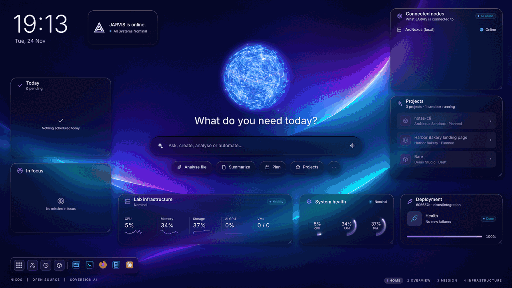
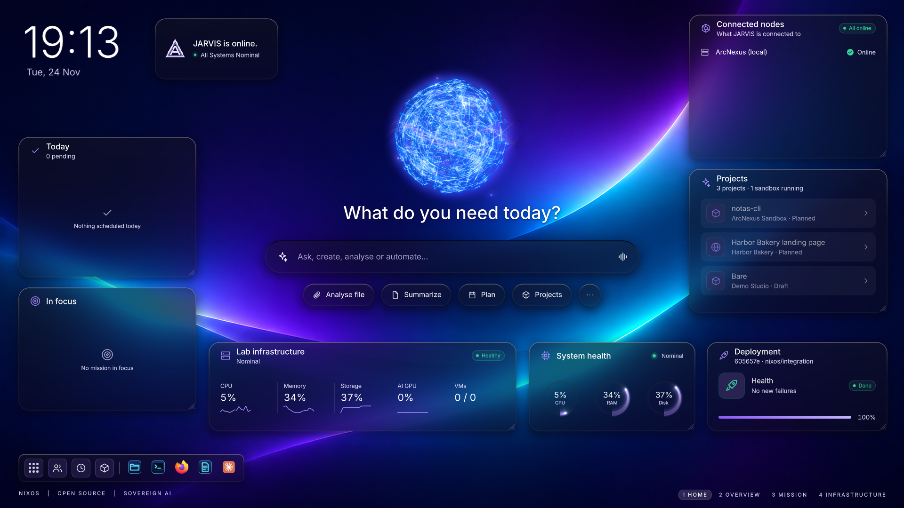
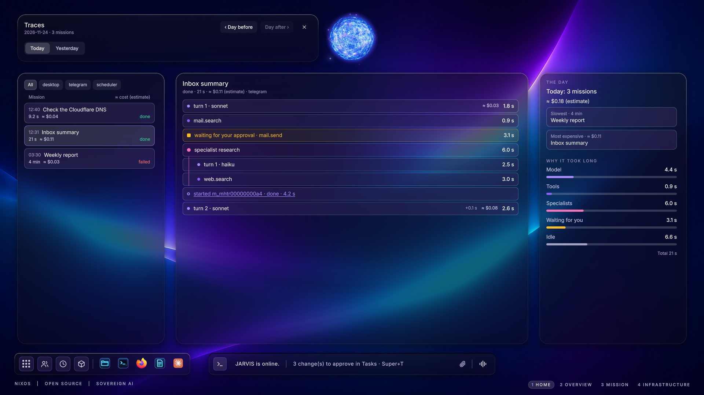
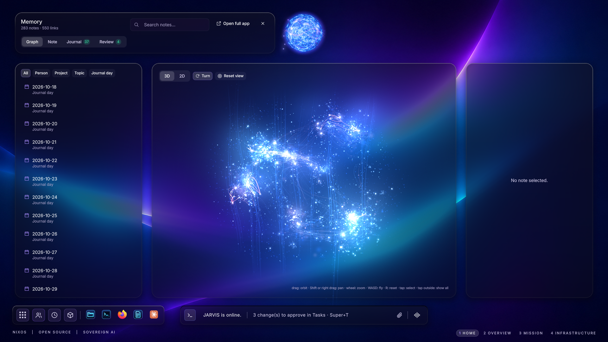
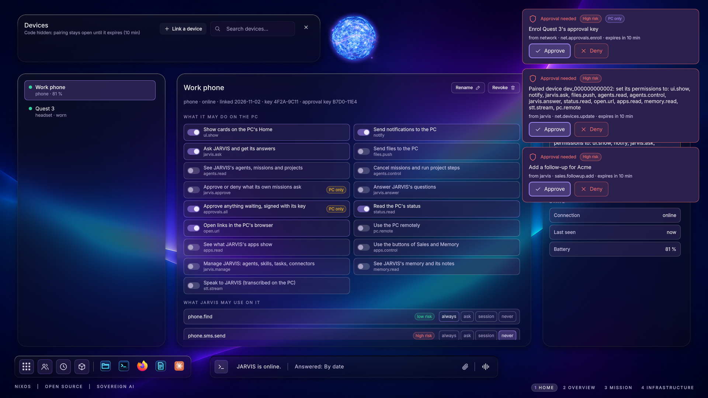
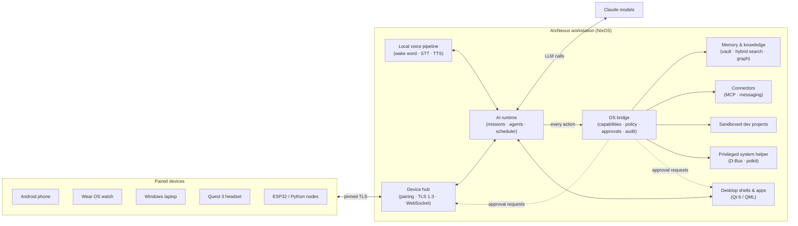

# ArcNexus

**An AI-native Linux desktop and device ecosystem: an assistant (JARVIS) that can act on the operating system — by voice, from any paired device — and never beyond what its owner has approved.**

> 🔒 **Source code is private — available for review upon request.**

---

## Overview

ArcNexus is a NixOS-based operating system whose desktop is built around JARVIS, an AI assistant that runs long tasks ("missions"), remembers what it learns and controls the machine through a single audited gateway. It solves the core problem of agentic assistants on a personal computer: giving a language model real power over files, apps, projects and system settings without letting it act outside the owner's rules. The same assistant is reachable from a phone, a watch, a Windows laptop and a mixed-reality headset over one pinned, end-to-end encrypted protocol. The ecosystem spans six codebases (the OS, an agent SDK and four device clients) — the OS repository alone holds about 1,900 commits and roughly 145k lines of Rust, 68k of TypeScript and 55k of QML (tests included).

## Demo

<!-- Replace the placeholders below with real media in ./assets -->

▶️ **Video walkthrough:** [PENDIENTE: link to demo video]

| Desktop | Voice & missions |
|---|---|
|  |  |

| Memory graph | Devices |
|---|---|
|  |  |

## Key Features

- **Missions with human approval** — JARVIS plans, executes, verifies and reports multi-step tasks; anything risky pauses for an approval that can be given on the PC, from the command line or from a paired device with biometrics.
- **A fully local voice loop** — wake word, voice-activity detection, speech-to-text and text-to-speech all run on the workstation itself, with the heavy models on its GPUs. Measured: speech-to-text p95 ≈ 310 ms in the pipeline, first audio of the reply in ≈ 40 ms, hands-free turns with barge-in.
- **One assistant, many devices** — an Android phone, a Wear OS watch, a Windows laptop and a Meta Quest 3 headset pair by QR code and, depending on the device, can ask JARVIS, hear its voice, show its cards and panels, send files and approve actions. SDKs for Python and ESP32 open the same protocol to custom nodes.
- **Long-term memory you can see** — a Markdown knowledge vault with a hybrid (keyword + vector) search index and an interactive 3D "brain" that renders the knowledge graph as a nebula of light.
- **Two native desktop shells and eight first-party apps** — a classic shell and a "holographic" shell that the assistant composes at run time, plus settings, files, terminal, editor, memory, scheduler and more, built on a token-based design system.
- **Specialist agents, skills and schedules** — 24 specialist agents, a scheduler for both model-free and agent tasks, external connectors through the Model Context Protocol (e.g. email), and development projects that build and test inside an offline sandbox.

## Tech Stack

| Category | Technologies |
|---|---|
| **Languages** | Rust, TypeScript, C++20, QML/JavaScript, Kotlin, Python, C, GLSL, Nix, Bash |
| **AI runtime** | Node.js, Claude Agent SDK, Anthropic SDK, Model Context Protocol SDK, Zod; an in-house deterministic agent SDK (TypeScript) benchmarked against the reference SDK |
| **System services** | Rust (thread-based, no async runtime), rustls (TLS 1.3), tungstenite (WebSocket), zbus (D-Bus), polkit, bubblewrap sandboxing, systemd |
| **Storage & search** | SQLite (WAL, FTS5), vector embeddings (Qwen3-Embedding served by llama.cpp), Markdown/Obsidian vault, append-only audit log |
| **Desktop** | Qt 6 Quick/QML, C++20, Wayland (labwc and Hyprland), LayerShellQt, Quickshell, custom GLSL shaders, three.js, CMake + Ninja |
| **Voice & local AI** | openWakeWord, Silero VAD, Whisper large-v3-turbo, Qwen3-TTS, ZONOS3, Kokoro, Piper, llama.cpp (CUDA), PyTorch/transformers |
| **Device clients** | Android (Kotlin, Jetpack Compose, TensorFlow Lite), Wear OS (Compose for Wear, Watch Face Format), Windows (Tauri 2, Rust, Windows Hello, OpenVINO), Meta Quest 3 (Unity, C#), ESP32 (C, ESP-IDF) |
| **Infrastructure** | NixOS flakes (workstation, VM and installer-ISO targets), reproducible builds, NixOS VM tests, SDDM and Plymouth themes |
| **Testing** | Rust unit and integration tests (≈ 2,000 test functions), Node test runner (≈ 110 test files), Qt Test, protocol conformance suite, end-to-end suites against the running services |

## Architecture

The system is a set of small single-purpose services on one workstation that talk over local sockets with kernel-verified caller identity. The **AI runtime** decides *what* to do; it has no direct access to the system and must send every action to the **OS bridge**, which checks it against a capability catalogue, the owner's policy and — when required — a human approval, then records it. Other services (memory, connectors, projects, devices) plug their capabilities into that same bridge, so there is exactly one place where actions are authorised and audited. Devices never reach the runtime directly: they go through the **device hub**, which handles pairing, encryption and offline queues.

## Technical Challenges

### 1. Letting a language model act on a real OS — safely

- **Problem:** an agent that can run tools on a personal machine can also be tricked or simply wrong. The model must not be able to widen its own permissions, approve its own requests or reach credentials.
- **Solution:** the model's built-in tools are removed and every action goes through one gateway with typed capabilities, risk levels and a policy that can only make rules stricter. Approvals are single-use, tied to the exact action and its parameters, and short-lived; the gateway rejects any approval that originates from the assistant's own service, and the assistant runs as a separate operating-system user. Device approvals must be signed by a hardware-backed key that only unlocks with biometrics or a PIN. System updates proposed by the assistant are built from committed code only, refuse to touch security-critical configuration and roll back automatically if the system comes up unhealthy.
- **Result:** in testing, an out-of-policy tool call was blocked in 76 ms before reaching the system; a dated egress audit documents every way data can leave the machine and the decision taken for each.

### 2. One secure protocol for very different devices

- **Problem:** a phone, a watch, a Windows laptop, a headset and a microcontroller all need to talk to the same assistant, with different capabilities and networks, and the protocol had to gain stronger identity checks without locking out devices already in use.
- **Solution:** a single versioned protocol over TLS 1.3 and WebSocket with QR pairing and certificate pinning. Two protocol versions run side by side with negotiation; the newer one adds a proof of device identity so a stolen token alone cannot open a session, and a device that has upgraded can never be downgraded. Each device declares what it can do, and the PC caps those declarations with minimum risk levels. Pushes for offline devices are queued, and the watch can tunnel through the phone while keeping encryption end to end.
- **Result:** reference SDKs in Rust, Python and C plus native Kotlin clients, with a conformance suite and end-to-end tests against the real hub guarding the protocol.

### 3. Making the assistant's memory actually findable

- **Problem:** keyword search over the knowledge vault failed on paraphrased questions and on questions asked in a different language from the notes — the assistant "forgot" things it had written down.
- **Solution:** a hybrid recall that fuses keyword and vector rankings while keeping exact names on top, evaluated on a labelled set of 80 queries and benchmarked up to millions of documents before becoming the default.
- **Result:** top-1 hit rate rose from 0.53 to 0.84 overall and from 0.21 to 0.79 for cross-language queries, with recall answering in 29 ms at p95 on the live index and 37 ms at 500,000 documents.

## What I Learned

<!-- [PENDIENTE: confirm or rewrite these in your own words] -->

- **Measure before keeping.** Optimisations were benchmarked against a noise baseline, and several promising ideas were removed because they did not beat it — a habit that kept the system simpler than its feature list suggests.
- **Security is architecture, not a feature.** Funnelling every action through one gateway, with identity verified by the kernel rather than by the caller, made the safety properties testable instead of aspirational.
- **Contracts scale better than code sharing.** A written, versioned protocol with a conformance suite let five platforms in four languages evolve independently without breaking each other.

## Contact

- 📧 **Email:** [PENDIENTE: your email]
- 💼 **LinkedIn:** [PENDIENTE: your LinkedIn URL]

*Source code is available for review upon request.*
